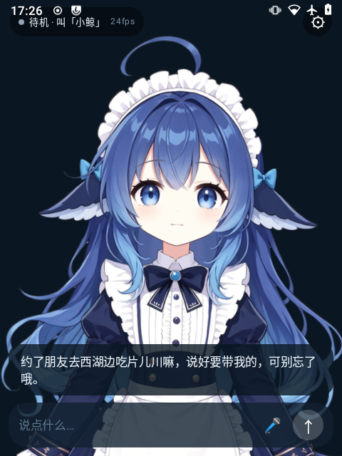
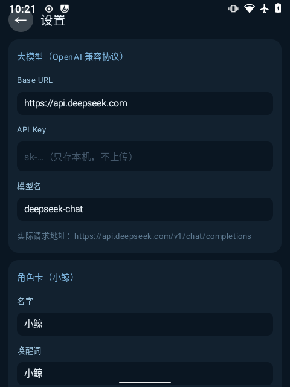

# Virtual Companion · Xiao Jing (小鲸)

[](LICENSE)
[-3ddc84.svg)](#getting-started)
[](https://github.com/k2-fsa/sherpa-onnx)
[](https://github.com/SZTMBABY/virtual-companion/actions/workflows/android.yml)

A voice companion that runs on Android: say “小鲸” (Xiao Jing) to wake it, talk to
it with your voice, and it answers as a Live2D character that remembers things you
told it long ago.

This is not a demo shell. Every link in the chain was verified on a low-end 2019
phone (Android 11 / 4×A53 / 3 GB / 640×480): on-device wake word, cloud speech,
Live2D rendering and context compression.

[中文说明](README.md) · [Third-party licenses](THIRD_PARTY_NOTICES.md)

| Idle | Settings |
|:---:|:---:|
|  |  |

> The character model in the screenshots is **not distributed** with this repo
> (see “Model licensing”). With your own model the UI looks the same, only the
> character differs. More device screenshots: [`docs/proof/`](docs/proof/).

---

## Features

| Capability | How | Measured |
|---|---|---|
| **Wake word** | On-device KWS (sherpa-onnx Zipformer, 8.4 MB), phrase “小鲸” | hit on device, 6 ms wake latency |
| **Voice chat** | Tencent Cloud streaming ASR (WebSocket) → LLM → Volcengine Doubao TTS (bidirectional streaming) | ~4 s per turn end-to-end |
| **Offline fallback** | On-device ASR (sherpa-onnx 14M int8, 25 MB); falls back automatically when cloud fails | RTF ≈ 0.3 |
| **Live2D** | WebView + official Cubism Core 5.1, 174 parameters driven in code | 24 fps capped, +19 MB PSS |
| **Character card** | Two layers: owner persona + character, fully editable | visual editing in Settings |
| **Long-term memory** | billion-context kernel vendored as-is (not rewritten) | compresses to 24–33 %, survives restarts |
| **Any endpoint** | Any OpenAI-compatible endpoint (DeepSeek / Ollama / one-api / OpenRouter …) | `/v1/models` discovery supported |

---

## Getting started

**Requirements**: JDK 17+ (Android Studio's bundled JBR is fine), Android SDK
Platform 37 + build-tools, and an arm64 device or emulator. The Gradle wrapper
is included.

### 1. Fetch models and native libraries (required)

Large binaries are **not committed** (keeps the repo ~100 MB lighter and avoids
re-publishing upstream artifacts). Fetch and verify them first:

```bash
bash tools/fetch_models.sh
```

> **Windows**: run this in **Git Bash** (bundled with Git for Windows). PowerShell
> and CMD cannot run `.sh` files. Run it from the project root; no admin rights needed.

The script:

1. downloads `sherpa-onnx-v2.0.1.aar` (48 MB) from JitPack → `app/libs/`
2. downloads the sherpa-onnx ASR / KWS archives and extracts only the needed files → `app/src/main/assets/{asr,kws}/`
3. downloads `silero_vad.onnx` from hf-mirror / HuggingFace → `app/src/main/assets/vad/`
4. verifies every file against [`tools/models.sha256`](tools/models.sha256); a mismatch is a hard error and no partial file is left behind

Options and environment variables:

```bash
bash tools/fetch_models.sh --aar-only      # AAR only
bash tools/fetch_models.sh --models-only   # models only
bash tools/fetch_models.sh --force         # re-download

GH_PROXY=https://ghfast.top bash tools/fetch_models.sh   # proxy GitHub release assets
VC_CACHE_DIR=/path/to/cache bash tools/fetch_models.sh   # reuse a download cache (defaults to .cache/models)
```

> On failure the script prints exactly which path to drop a manual download into.
> In mainland China `release-assets.githubusercontent.com` is often unreachable;
> use `GH_PROXY` or place the archive in the cache directory yourself.
> If you already have the binaries locally, just skip this step — the script
> detects them as “ready”.

### 2. Build and install

```bash
./gradlew :app:assembleDebug
adb install -r app/build/outputs/apk/debug/app-debug.apk
```

The APK is about **100 MB** (speech models + the AAR's `.so` files) and requires
**arm64-v8a, Android 8.0+** (`minSdk 30`).

> `gradle-wrapper.properties` points at `services.gradle.org`. If that download is
> slow, temporarily switch it to a mirror (e.g.
> `https://mirrors.cloud.tencent.com/gradle/gradle-9.6.0-bin.zip`) or use a locally
> installed Gradle 9.6.0.
> If you skipped step 1, Gradle fails immediately with “missing models / native
> libraries” plus the command to run, instead of a pile of missing-file errors.

### 3. Import a Live2D model

The app ships without a model (licensing, see below). On first launch go to
**Settings → Live2D model → Import** and pick a directory containing `.model3.json`.

Model requirements:
- Cubism 3/4/5 (`.moc3`)
- textures no larger than **4096 px** per side (low-end GL limit; 8192 renders black)
- no `Motions` file needed — breathing, blinking and lip-sync are all code-driven

### 4. Enter credentials (Settings page only, never baked into the APK)

| Section | Fields | Notes |
|---|---|---|
| LLM | Base URL / API key / model name | DeepSeek `https://api.deepseek.com` pre-filled, key empty |
| Speech | Tencent AppId + SecretId + SecretKey | [console](https://console.cloud.tencent.com/asr) |
| Speech | Volcengine AppId + AccessKey + voice ID | [console](https://console.volcengine.com/speech) |

**It also runs with nothing configured**: text chat and all of Live2D work, TTS
becomes “silent acting” (lip-sync without audio).

### 5. Use it

With the screen on and the app in the foreground, say “小鲸” → it answers → after
8 s of silence it stops listening. You can also type. **Background wake word is not
supported yet**: Android reclaims the microphone once the screen is off.

---

## Implementation notes

### Why the wake word works on this device

The hard part: the target device has no GMS and no TTS engine at all, so
`SpeechRecognizer` is unusable; Porcupine's free tier is discontinued and
openWakeWord is English-only.

The solution is sherpa-onnx Zipformer KWS with the smallest Chinese model (8.4 MB).
Keywords are plain text lines of phonemes (`x iǎo j īng :2.0 @小鲸`), so changing
the wake phrase needs no retraining.

Three constraints learned the hard way:
1. `numThreads` must be **1**, otherwise onnxruntime dies with `pthread_setaffinity_np` on arm64;
2. the threshold must be **0.15** — the 0.35 default never fires;
3. never append `#threshold` to a keyword line — that syntax silently disables the whole line.

### Why not the system TTS

On the target device `settings get secure tts_default_synth` returns null and none
of the 204 installed packages exposes a TTS service. So TTS goes entirely through
Volcengine Doubao bidirectional streaming; PCM comes back and is fed to `AudioTrack`.

**Lip-sync is computed from the RMS of the PCM being played**, not from subtitle
timestamps — audio and mouth stay aligned forever, and swapping TTS vendors does
not affect it.

### How memory works

Rather than writing a new memory system, the
[billion-context](https://github.com/ranxianglei/billion-context) kernel is
**vendored as-is** into `app/src/main/assets/kernel/`, with `vc-memory.js` as the
single seam (9 methods); Kotlin only hosts the WebView and feeds messages.

Upgrading the kernel means replacing three JS files. The cost is an invisible
WebView (+19 MB PSS).

**The key trade-off**: the kernel's defaults target a 1M-token desktop context, so
`growthFloor=50000` never triggers in companion chat (2–4K tokens/day). We add a
“working set” notion (6K tokens) and scale the absolute thresholds, while leaving
the percentage gates (0.75 / 0.45 / 0.95) at their defaults.

### Why WebView instead of native rendering

The official Cubism SDK for Android core `.aar` is not in any public repository —
you must register and download it manually. The web core, however, is publicly
hosted. On Chromium 103 the device reports `csmGetVersion = 0x050100C0` (5.1.0)
and `csmGetLatestMocVersion = 5`, matching a moc3 v5 model, and holds 22–24 fps in
both orientations.

---

## Layout

```
app/src/main/
├── assets/
│   ├── kernel/           billion-context kernel (vendored) + vc-memory.js seam
│   ├── kws/              wake-word model (8.4 MB, fetched by fetch_models.sh)
│   ├── asr/              on-device ASR model (25 MB, fetched)
│   ├── vad/              Silero VAD (fetched)
│   └── l2d/              Cubism Core + pixi + render.html
├── java/com/example/virtualcompanion/
│   ├── data/
│   │   ├── chat/         OpenAI SSE streaming, prompts, JSON extraction
│   │   ├── memory/       kernel host, summary generation
│   │   └── model/        character card, settings
│   ├── voice/            KWS / ASR (local + Tencent) / TTS (Volcengine) / player / state machine
│   └── ui/               main screen, settings, Live2D composable
tools/
├── fetch_models.sh       download + sha256 verification for large binaries
└── models.sha256         expected checksums
docs/
├── 可行性方案.md          scope, technology choices, measurements, risks (Chinese)
├── 施工日志.md            per-phase build log (Chinese)
├── proof/                device screenshots
└── research/             7 research reports (Live2D / speech stack / memory / kernel …)
LICENSES/                 full texts of third-party licenses
```

---

## Known limitations

- **arm64-v8a only**: the AAR ships 4 ABIs but only arm64 is packaged for size; it will not run on x86 emulators;
- **verified on two devices only**: Android 11 GSI (2019 low-end phone) and Android 17 / HyperOS;
- **no background wake word**: listening only while the screen is on and the app is foregrounded;
- **single character**: one Live2D character and one owner persona, no switching;
- **limited animation**: without motion files you get breathing, blinking, lip-sync, head sway and four expressions;
- **no Cubism 2 support**: `.moc3` only (Cubism 3+);
- **needs the cloud**: ASR and TTS require network; offline is text-only; commercial APIs need your own keys and terms;
- **memory compression costs a call**: compaction is a real LLM request and spends tokens;
- **summaries keep filler words**: compacted summaries may retain “mm”, “ah”, etc.;
- **first syllable may drop**: audio before the first TTS packet arrives is incomplete;
- **character card export missing**: personas can only be edited locally;
- **no soak test**: 10+ back-to-back turns without a restart is not systematically verified.

---

## Model licensing

This repository contains **no Live2D model files**, and none of the character
shown in the screenshots. The test model used during development came from a
third-party export whose `.vtube.json` sets `"WorkshopSharingForbidden": true` and
which shipped no license text — redistribution status is unclear, so the rule is
that you import a model you have rights to.

Screenshots under `docs/proof/` were taken with that test model and serve as
functional evidence only; **the artwork in them is not covered by this project's
license**. Bring your own licensed model to reproduce the look.

**Live2D Cubism Core** (`app/src/main/assets/l2d/live2dcubismcore.min.js`) is
governed by the
[Live2D Proprietary Software License](https://www.live2d.com/eula/live2d-proprietary-software-license-agreement_en.html)
and is redistributed as “Redistributable Code”. It is **not** open source and is
**not** covered by this project's MIT license. Personal/small-scale releases are
royalty-free; check the terms for commercial use.

---

## License

This project's own code is released under the [MIT license](LICENSE). Third-party
components (Live2D Cubism Core, pixi.js, pixi-live2d-display, sherpa-onnx, Silero
VAD, billion-context, AndroidX, …) keep their own licenses — see
**[THIRD_PARTY_NOTICES.md](THIRD_PARTY_NOTICES.md)** and [`LICENSES/`](LICENSES/).

---

## Acknowledgements

Context compression is ported from
**[billion-context](https://github.com/ranxianglei/billion-context)** and its kernel
**[acp-kernel](https://github.com/ranxianglei/acp-kernel)**. The upstream license is
MIT plus an attribution clause, satisfied here by this statement: this project uses
billion-context and acp-kernel.

Other dependencies:
- [sherpa-onnx](https://github.com/k2-fsa/sherpa-onnx) — ASR / KWS engine (Apache-2.0)
- [Live2D Cubism SDK](https://www.live2d.com/cubism/) — Live2D runtime (proprietary)
- [PixiJS](https://pixijs.com/) + [pixi-live2d-display](https://github.com/guansss/pixi-live2d-display) — rendering (MIT)
- [Silero VAD](https://github.com/snakers4/silero-vad) — voice activity detection (MIT)
- Tencent Cloud streaming ASR, Volcengine Doubao speech synthesis
