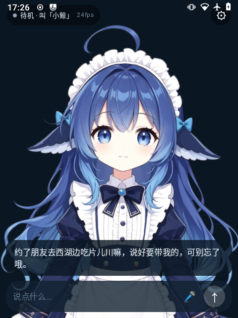
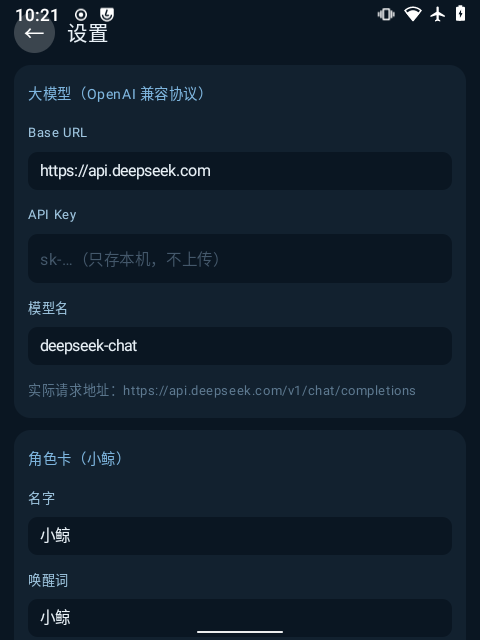

# 虚拟伴侣 · 小鲸

[](LICENSE)
[-3ddc84.svg)](#快速开始)
[](https://github.com/k2-fsa/sherpa-onnx)
[](https://github.com/SZTMBABY/virtual-companion/actions/workflows/android.yml)

一个跑在 Android 上的语音虚拟伴侣：喊一声「小鲸」就能唤醒，用语音聊天，
对面是一个 Live2D 角色，记得住很久以前说过的事。

不是演示壳子——所有链路都在一台 2019 年的低端真机（Android 11 / 4×A53 / 3GB /
640×480）上跑通过，包含本地唤醒、云端语音、Live2D 渲染和上下文压缩。

[English](README.en.md) · [第三方许可](THIRD_PARTY_NOTICES.md)

| 待机 | 设置 |
|:---:|:---:|
|  |  |

> 截图中的角色模型**不随仓库分发**（见「关于模型授权」）。你用自己的模型跑起来后，
> 界面结构一致，只是角色不同。更多真机截图见 [`docs/proof/`](docs/proof/)。

---

## 它能做什么

| 能力 | 实现 | 实测 |
|---|---|---|
| **语音唤醒** | 本地 KWS（sherpa-onnx Zipformer，8.4MB）+ 唤醒词「小鲸」 | 真机命中，唤醒延迟 6ms |
| **语音交流** | 腾讯云实时 ASR（WebSocket）→ LLM → 火山豆包 TTS（双向流式） | 端到端一轮 ~4s |
| **离线兜底** | 本地 ASR（sherpa-onnx 14M int8，25MB），云端失败自动降级 | RTF ≈ 0.3 |
| **Live2D 互动** | WebView + 官方 Cubism Core 5.1，174 个参数程序化驱动 | 24fps 锁帧，PSS +19MB |
| **角色卡** | 两层：主人的 Persona + 角色的 Character，全可改 | 设置页可视化编辑 |
| **长记忆** | 移植 billion-context 内核（原样 vendor，非重写） | 压缩到 24~33%，跨重启保留 |
| **多端点** | 任何 OpenAI 协议端点（DeepSeek / Ollama / one-api / OpenRouter…） | 支持 `/v1/models` 拉模型 |

---

## 快速开始

**环境**：JDK 17+（Android Studio 自带 JBR 即可）、Android SDK Platform 37 + Build-Tools、
一台 arm64 真机或模拟器。项目用 Gradle wrapper，仓库自带 `gradlew`。

### 1. 拉模型与原生库（必做）

仓库**不包含**大二进制（省 100MB+，也避免重发上游产物）。首次构建前先取下来：

```bash
bash tools/fetch_models.sh
```

脚本会：

1. 从 JitPack 取 `sherpa-onnx-v2.0.1.aar`（48MB）→ `app/libs/`
2. 从 sherpa-onnx releases 取 ASR / KWS 模型包，只解出需要的文件 → `app/src/main/assets/{asr,kws}/`
3. 从 hf-mirror / HuggingFace 取 `silero_vad.onnx` → `app/src/main/assets/vad/`
4. 每个文件按 [`tools/models.sha256`](tools/models.sha256) 校验 sha256，不匹配即报错，不会留下半截文件

常用选项与环境变量：

```bash
bash tools/fetch_models.sh --aar-only      # 只取 AAR
bash tools/fetch_models.sh --models-only   # 只取模型
bash tools/fetch_models.sh --force         # 忽略已有文件，重新下载

GH_PROXY=https://ghfast.top bash tools/fetch_models.sh   # GitHub 资产走代理
VC_CACHE_DIR=/path/to/cache bash tools/fetch_models.sh   # 复用下载缓存（默认 .cache/models）
```

> 下载失败时脚本会把「该手动放到哪个路径」打出来。国内网络访问
> `release-assets.githubusercontent.com` 常不通，用 `GH_PROXY` 或手动下载后放进缓存目录均可。
> 已经拿到本地二进制的开发者也可以直接跳过这一步（脚本会自动识别「已就绪」）。

### 2. 编译安装

```bash
./gradlew :app:assembleDebug
adb install -r app/build/outputs/apk/debug/app-debug.apk
```

APK 约 **100MB**（含语音模型与 AAR 里的 `.so`），需要 **arm64-v8a + Android 8.0+**（`minSdk 30`）。

> `gradle-wrapper.properties` 指向 `services.gradle.org`。国内网络下载缓慢时，
> 可临时把它改成镜像地址（例如 `https://mirrors.cloud.tencent.com/gradle/gradle-9.6.0-bin.zip`），
> 或直接用本机已安装的 Gradle 9.6.0。
> 若忘记执行第 1 步，Gradle 会直接报「缺少构建所需的模型 / 原生库」并提示命令，不会给你一堆缺文件错误。

### 3. 导入 Live2D 模型

App 不含模型（授权原因，详见下方「关于模型授权」）。
首启后进 **设置 → Live2D 模型 → 导入模型**，选一个含 `.model3.json` 的目录。

模型要求：
- Cubism 3/4/5 均可（`.moc3`）
- 贴图边长 **≤ 4096**（低端机 GL 上限；8192 会直接黑屏）
- 没有 `Motions` 也能用——呼吸、眨眼、口型全部代码驱动

### 4. 填密钥（全部在设置页，不打包进 APK）

| 区块 | 需要填 | 说明 |
|---|---|---|
| 大模型 | Base URL / API Key / 模型名 | DeepSeek 已预填 `https://api.deepseek.com`，Key 留空 |
| 语音 | 腾讯 AppId + SecretId + SecretKey | [控制台](https://console.cloud.tencent.com/asr) |
| 语音 | 火山 AppId + AccessKey + 音色 ID | [控制台](https://console.volcengine.com/speech) |

**一个都不填也能跑**：文字聊天 + Live2D 全功能可用，TTS 会「静音演戏」（有口型无声音）。

### 5. 用

亮屏在前台时喊「小鲸」→ 它应答 → 说完后 8 秒静默超时退出聆听。
也可以直接打字。**后台常驻唤醒暂未支持**：只在 App 前台、屏幕点亮时监听（关屏后系统会回收麦克风）。

---

## 技术要点

### 为什么唤醒能在这台机器上跑

**难点**：目标机无 GMS、无任何 TTS 引擎，`SpeechRecognizer` 不可用；
Porcupine 免费层已停用，openWakeWord 只有英文。

**解法**：sherpa-onnx 的 Zipformer KWS，中文最小集 8.4MB，
关键词用音素串写成一行文本（`x iǎo j īng :2.0 @小鲸`），改唤醒词不用重新训练。

三个实测踩出来的硬约束：
1. `numThreads` 必须是 **1**，否则 onnxruntime 在 arm64 上 `pthread_setaffinity_np` 报错崩溃；
2. 阈值 **0.15**，默认 0.35 永远不触发；
3. 关键词行里**不要写 `#阈值`**——那个语法会让整行关键词静默失效。

### 为什么不用系统 TTS

目标机 `settings get secure tts_default_synth` 返回 null，204 个包无一含 tts 服务。
所以 TTS 全部走火山豆包双向流式，音频以 PCM 回来，自己喂给 `AudioTrack`。

**口型的来源是播放中的 PCM 逐块算 RMS**，不是字幕时间戳——
这样音画永远对齐，TTS 换供应商也不影响口型。

### 记忆怎么做的

不是自己写一套，而是把 [billion-context](https://github.com/ranxianglei/billion-context)
的内核**原样 vendor** 进 `app/src/main/assets/kernel/`，
用 `vc-memory.js` 做唯一的接缝（9 个方法），Kotlin 侧只负责承载 WebView 和喂消息。

这样做的好处是内核升级只要替换三个 js 文件。代价是需要一个不可见的 WebView（+19MB PSS）。

**关键取舍**：内核默认参数是给 1M 窗口的桌面场景调的，
`growthFloor=50000` 在伴侣对话里（一天 2~4K token）永远不触发。
所以引入「工作集」概念（6K token）并缩放绝对门槛，
百分比门（0.75 / 0.45 / 0.95）保持内核默认不动。

### 为什么是 WebView 而不是原生渲染

官方 Cubism SDK for Android 的 Core `.aar` 不在仓库里，需要注册后手动下载；
而 Web 版 Core 是公开 CDN 就能取的。实测在 Chromium 103 上
`csmGetVersion = 0x050100C0`（5.1.0）、`csmGetLatestMocVersion = 5`，
和模型的 moc3 v5 完全匹配，横竖屏都能跑到 22~24fps。

---

## 目录结构

```
app/src/main/
├── assets/
│   ├── kernel/           billion-context 内核（原样 vendor）+ vc-memory.js 接缝
│   ├── kws/              唤醒模型（8.4MB，fetch_models.sh 下载）
│   ├── asr/              本地 ASR 模型（25MB，fetch_models.sh 下载）
│   ├── vad/              Silero VAD（fetch_models.sh 下载）
│   └── l2d/              Cubism Core + pixi + render.html
├── java/com/example/virtualcompanion/
│   ├── data/
│   │   ├── chat/         OpenAI SSE 流式、提示词、JSON 抽取
│   │   ├── memory/       内核承载、摘要生成
│   │   └── model/        角色卡、设置
│   ├── voice/            KWS / ASR（本地+腾讯）/ TTS（火山）/ 播放器 / 状态机
│   └── ui/               主界面、设置页、Live2D 组件
tools/
├── fetch_models.sh       下载 + sha256 校验大二进制
└── models.sha256         期望校验值清单
docs/
├── 可行性方案.md          需求边界、技术选型、实测证据、风险表
├── 施工日志.md            每个阶段的做了什么/怎么验/有无偏离
├── proof/                真机截图证据
└── research/             7 份预研报告（Live2D / 语音栈 / 记忆 / 内核 …）
LICENSES/                 第三方许可全文
```

---

## 已知限制

- **仅 arm64-v8a**：AAR 内含 4 个 ABI，为控体积只打包 arm64；x86 模拟器跑不了；
- **只在两类真机验证过**：Android 11 GSI（2019 低端机）与 Android 17 / HyperOS；其他 ROM 可能有差异；
- **无后台常驻唤醒**：仅前台亮屏监听，关屏/切后台后不再唤醒（系统会回收麦克风）；
- **单一角色**：只支持一个 Live2D 角色 + 一个主人人设，不支持多角色切换；
- **动画有限**：模型没有 motion 文件时只有呼吸/眨眼/口型/头部摆动/四种表情；
- **不支持 Cubism 2**：只吃 `.moc3`（Cubism 3+）；
- **依赖云端**：语音识别与合成需要网络，离线只能文字；商业云服务需自备密钥并遵守其条款；
- **记忆压缩额外调 LLM**：压缩是一次真实的模型调用，会多花 token；
- **摘要会夹带语气词**：压缩后的摘要可能把「嗯、呀」一并留下，属已知瑕疵；
- **首句可能丢字**：TTS 首包到达前的那一小段音频不完整；
- **角色卡导出未实现**：角色/人设只能在本机编辑，导出导入还没做；
- **长跑未压测**：连续 10 轮以上不重启的稳定性还没做系统性验证。

---

## 关于模型授权

仓库**不包含** Live2D 模型文件，也**不包含**截图里的那个角色。
开发时用的测试模型来自第三方导出包，其 `.vtube.json` 含
`"WorkshopSharingForbidden": true`，包内也没有任何许可文本——再分发的授权状况不明，
因此约定由使用者自行导入有授权的模型。

`docs/proof/` 里的截图是用该测试模型拍的，仅作功能证据；**图内角色的著作权不属于本项目**，
截图不构成对该角色任何形式的授权。想复现同样的画面请自行准备有授权的模型。

**Live2D Cubism Core**（`app/src/main/assets/l2d/live2dcubismcore.min.js`）采用
[Live2D Proprietary Software License](https://www.live2d.com/eula/live2d-proprietary-software-license-agreement_en.html)，
以 “Redistributable Code” 形式随应用分发，**不是开源软件**，不受本项目 MIT 许可覆盖。
个人/小规模发布免许可费，商业使用请自行确认条款。

---

## 许可

本项目自有代码以 [MIT](LICENSE) 发布。第三方组件（Live2D Cubism Core、pixi.js、
pixi-live2d-display、sherpa-onnx、Silero VAD、billion-context、AndroidX 等）
各自遵循其原许可，详见 **[THIRD_PARTY_NOTICES.md](THIRD_PARTY_NOTICES.md)** 与
[`LICENSES/`](LICENSES/)。

---

## 致谢与署名

本项目的上下文压缩机制移植自 **[billion-context](https://github.com/ranxianglei/billion-context)**
及其内核 **[acp-kernel](https://github.com/ranxianglei/acp-kernel)**。
原项目为 MIT + 附加署名条款，按条款在此声明：本项目使用了 billion-context 与 acp-kernel。

其他依赖：
- [sherpa-onnx](https://github.com/k2-fsa/sherpa-onnx) — ASR / KWS 引擎（Apache-2.0）
- [Live2D Cubism SDK](https://www.live2d.com/cubism/) — Live2D 运行时（专有许可）
- [PixiJS](https://pixijs.com/) + [pixi-live2d-display](https://github.com/guansss/pixi-live2d-display) — 渲染（MIT）
- [Silero VAD](https://github.com/snakers4/silero-vad) — 语音活动检测（MIT）
- 腾讯云实时语音识别、火山引擎豆包语音合成
